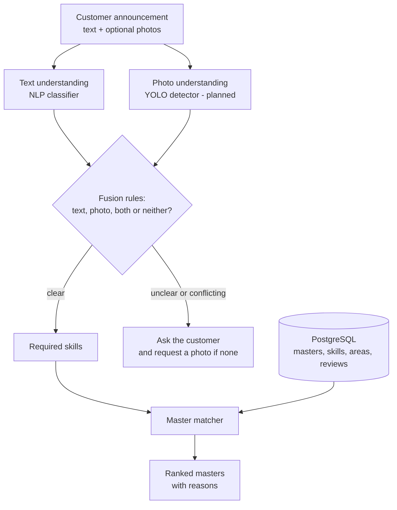

# Tapdix

> An AI-assisted marketplace that connects people who need something repaired with the right local master.
> Azerbaijani-first: listings can be written in Azerbaijani or Russian, with or without diacritics, typos included.

> **Status: working prototype (portfolio project).** Every machine-learning result in this repository was measured on
> **synthetic data** that I generated to build and test the pipeline. The numbers show that the system *works end to end*,
> not how accurate it will be on real customers. Collecting real data is the next milestone ([Roadmap](#14-roadmap)).

**Contents:**
[1 What is it](#1-what-is-tapdix) · [2 How it works](#2-how-it-works) · [3 Status](#3-project-status) ·
[4 Stack](#4-tech-stack) · [5 Layout](#5-repository-layout) · [6 Data](#6-data) · [7 ML and AI](#7-machine-learning-and-ai) ·
[8 Database](#8-database) · [9 API and web](#9-api-and-web-app) · [10 Engineering](#10-engineering-practices) ·
[11 Quickstart](#11-quickstart) · [12 Try it](#12-try-it-yourself) · [13 Limitations](#13-limitations) ·
[14 Roadmap](#14-roadmap) · [15 Glossary](#15-glossary) · [16 Security](#16-security-and-privacy-of-this-repository)

---

## 1. What is Tapdix?

A customer posts a request in their own words, for example *"Mətbəx kranı su axıdır, təcili lazımdır"* ("the kitchen
faucet is leaking, urgent"), optionally with photos. Tapdix:

1. **understands the problem**: which trade (category), which kind of problem, which repair skills are needed;
2. **decides what to trust**: the text, the photo, both, or neither, and **asks the customer** instead of guessing;
3. **ranks nearby masters** by skills, area, rating (small-sample safe), experience, verification and urgency fit, and explains each ranking in plain Azerbaijani.

In industry terms Tapdix is a **two-sided service marketplace** (customers on one side, masters on the other) delivered
as a **web platform**, with an **AI matching layer** (NLP + computer vision + ranking) on top. See the [glossary](#15-glossary).

**Eight core trades**, 56 problem types and 54 skills:

| Category (slug) | Azerbaijani | Typical problems |
|---|---|---|
| Plumbing (`plumbing`) | Santexnika | leaking faucet, clogged drain, burst pipe, toilet, water heater |
| Electrical Services (`electrical`) | Elektrik xidmətləri | no power, sparking socket, breaker trips, wiring, burning smell |
| Locksmith Services (`locksmith`) | Kilid ustası | locked out, lost keys, jammed lock, car lockout |
| Appliance Repair (`appliance_repair`) | Məişət texnikası təmiri | washer, fridge, dishwasher, oven, small appliances |
| Automotive Repair (`automotive_repair`) | Avtomobil təmiri | won't start, brakes, diagnostics, suspension, tyres |
| Electronics Repair (`electronics_repair`) | Elektronika təmiri | cracked screen, not charging, laptop, TV, water damage |
| Painting & Renovation (`painting_renovation`) | Rəngsazlıq və təmir | painting, wallpaper, plaster, tiling, flooring, full renovation |
| HVAC Services (`hvac_services`) | İsitmə, havalandırma, kondisioner | AC not cooling/leaking/installation, radiator, boiler, ventilation |

## 2. How it works



| Step | Module | What happens |
|---|---|---|
| 1 | `tapdix_ml.text` | Azerbaijani-aware lower-casing, diacritic folding (`sıxmır` = `sixmir`), phone/e-mail redaction |
| 2 | `tapdix_ml.nlp` | Text → problem type (56 classes) → category, with a confidence and the words that drove the decision |
| 3 | `tapdix_ml.vision` | Fusion policy (see [7.4](#74-text-vs-photo-fusion)); consumes YOLO output, so it is testable without a GPU |
| 4 | `tapdix_ml.matching` | Required skills (weighted by the model's uncertainty) → ranked masters + human-readable reasons |
| 5 | `db/` | PostgreSQL stores masters, listings, offers, jobs, reviews and the training-consent flag |

## 3. Project status

| Area | Status | Notes |
|---|---|---|
| Taxonomy (8 categories, 56 problem types, 54 skills) | **Built** | one JSON file feeds both the ML code and the SQL seed |
| Synthetic dataset + generator | **Built** | 4,480 listings, 400 masters, fully reproducible |
| NLP text classifier | **Built** | evaluated on synthetic data only |
| Text-vs-photo fusion logic | **Built** | tested with *simulated* detections |
| YOLO photo detector | **Planned** | label set + folder layout ready; no photos collected yet |
| Master matcher v0 | **Built** | rule-based, explainable baseline |
| Learned ranker | **Planned** | needs real hire/review outcomes |
| Legacy scorer ported to Python | **Built** | proven identical to the original by 323 parity tests |
| PostgreSQL schema + hardening | **Built** | 22 automated assertions, tested on PostgreSQL 16 |
| REST API (FastAPI) | **Skeleton** | health endpoint only |
| Web app (React) | **Scaffold** | builds and tests; screens not built yet |
| CI (GitHub Actions) | **Defined** | Python, web and database jobs |
| Real users, real data | **None yet** | |

## 4. Tech stack

| Layer | Technology |
|---|---|
| ML / NLP | Python 3.12, scikit-learn (TF-IDF + logistic regression), NumPy, SciPy, joblib |
| Planned ML | YOLO via Ultralytics, LightGBM (ranking), sentence-transformers (multilingual embeddings), MLflow (experiment tracking) |
| Database | PostgreSQL 16 (schema targets 14+), SQL migrations, constraint triggers |
| API | FastAPI, Pydantic |
| Web | Vite 8, React 19, TypeScript 6, Tailwind CSS 4, Vitest, ESLint |
| Quality | pytest, ruff (lint + format), GitHub Actions |
| Original prototype | TypeScript (rule-based scorer), kept in `legacy/` as the baseline to beat |

## 5. Repository layout

```
tapdix/
├── apps/web/                  React + TypeScript + Tailwind (Vite) scaffold, with a test
├── services/api/              FastAPI service (health endpoint so far) + tests
├── ml/
│   ├── src/tapdix_ml/
│   │   ├── baseline/          1:1 Python port of the legacy scorer
│   │   ├── data/              taxonomy loader, synthetic generator, photo indexer, SQL-seed generator
│   │   ├── text/              Azerbaijani-aware normalisation + PII redaction
│   │   ├── nlp/               classifier, evaluation (risk-coverage, learning curve), training CLI
│   │   ├── vision/            text-vs-photo fusion
│   │   ├── matching.py        v0 master matcher
│   │   ├── pipeline.py        end-to-end recommend()
│   │   └── demo.py            try it from the command line
│   ├── data/
│   │   ├── taxonomy/          taxonomy.json + phrasebank.json (single source of truth)
│   │   ├── synthetic/         generated dataset + DATASET_CARD.md
│   │   ├── gold/              independent test messages
│   │   ├── vision/            YOLO label set (objects + defects)
│   │   └── images/            photo folder skeleton (images are git-ignored)
│   ├── reports/               evaluation report (JSON)
│   └── tests/                 10 test modules (+ services/api/tests)
├── db/                        migrations, taxonomy seed, demo data, verification, apply scripts
├── legacy/                    original TypeScript scorer + tools that generate the parity fixtures
├── docs/                      legacy-engine audit, SQL audit, product inventory
└── .github/workflows/ci.yml
```

## 6. Data

### 6.1 Taxonomy: one source of truth
`ml/data/taxonomy/taxonomy.json` defines every category, problem type, skill and the problem→skill mapping.
`python -m tapdix_ml.data.taxonomy_sql` generates `db/seed_taxonomy.sql` from it, and a test fails if the committed SQL
drifts from the JSON. The model, the matcher and the database therefore always speak the same vocabulary.

### 6.2 Synthetic dataset
There is no real marketplace data yet, so `tapdix_ml.data.generate` builds a reproducible dataset (fixed seed, byte-identical on re-run):

| | |
|---|---|
| Listings | 4,480 (56 problem types × 80), as JSON announcements (`listings.jsonl`) and a flat table (`listings.csv`) |
| Language | ~83% Azerbaijani, ~17% Russian |
| Noise | 30% typed without diacritics, 12% with typos, mixed upper/lower case, 8% deliberately *vague* ("Kömək lazımdır") |
| Masters | 400 synthetic masters with skills, service areas, rating, availability |
| Photos | none; the CSV has a `photo_paths` column ready for links, see [6.4](#64-photos) |

How the text is made: **hand-written Azerbaijani and Russian phrasings** (392 title+sentence bundles) are combined with
random context sentences (time, district, budget, urgency, request) and then noised. Because whole sentences are
hand-written, there are no broken suffix/agreement errors from template filling.

**Train/test are split by phrasing**, not randomly. Test listings use wordings the model never saw in training, so the
test measures generalisation across wording, not memorisation. A test enforces that no phrasing crosses the split.

### 6.3 Gold set
`ml/data/gold/gold.json`: 80 clear and 12 vague informal messages (no-diacritics, Russian, very short), written
separately from the phrase bank and **never used for training**. Caveat: the same author wrote both, so this set is
optimistic. A gold set labelled by someone else, from real listings, is on the roadmap.

### 6.4 Photos
Photos live in `ml/data/images/<category>/<problem_type>/` (56 prepared folders; the folder name *is* the label).
`python -m tapdix_ml.data.index_photos` validates folder names, rejects duplicates and writes `photos_index.csv`
(path, label, SHA-256), and those paths are the links stored in the tabular data. Photos are git-ignored: they are large and private.
The YOLO label set is in `ml/data/vision/classes.json` (39 object classes that say *what* is in the photo, 8 defect classes that say *what is wrong*).

### 6.5 Privacy by design
* Training is opt-in: `customer_profiles.ml_training_consent` (with a timestamp constraint).
* The view `ml_training_listings` exposes **no** names, phones, e-mails, exact addresses or coordinates, only consenting
  customers, only published listings, only photos whose EXIF (GPS) was stripped.
* Free text can still contain phone numbers, so `text.normalize.redact_pii` removes phones/e-mails before any text reaches a model.
* All people, phones and e-mails in demo data are fictional.

## 7. Machine learning and AI

### 7.1 Baseline: the legacy scorer, ported and proven
The first version of the product ranked workers with a hand-weighted TypeScript scorer (`legacy/ai/`, six modules): not
machine learning, but a baseline every model must beat. I ported it **1:1 to Python** (`tapdix_ml.baseline`) and proved equivalence:

* a script runs the **original TypeScript** on 248 scored pairs and 75 ranking cases and records the outputs;
* **323 parity tests** require exact equality (scores, labels, Azerbaijani explanation text, ranking order);
* the test suite was **mutation-tested**: deliberately breaking rounding, float summation or number formatting makes tests fail.

Auditing it also surfaced **15 defects** (`docs/legacy_engine_audit.md`), for example reliability can never reach 100 (it tops out near 84) because of a scale mismatch,
one 5.0-star review outranks fifty 4.8-star reviews, scoring mutates its input arrays, and location matching fails on `İ`/`ı`.

### 7.2 NLP model: text → problem type → category
* **Features**: TF-IDF over *character* 2–5-grams (robust to Azerbaijani suffixes and typos: `kran`, `kranın`, `kranı` share a core) plus word 1–2-grams.
* **Classifier**: multinomial logistic regression over the 56 problem types.
* **Category probability = sum of its problem-type probabilities**, so category and problem type can never contradict each other.
* **Explainable**: the words that pushed the prediction are returned (`kranin`, `damir` for a faucet leak).
* **Normalisation** (`tapdix_ml.text`): Azerbaijani lower-casing (`I`→`ı`, `İ`→`i`), diacritic folding, repeated-letter collapsing, PII redaction.

Why a linear model first: it trains in seconds, gives usable probabilities, can explain itself, and sets an honest
baseline before a transformer is justified.

### 7.3 Confidence and abstention
A model that always answers is dangerous. Tapdix measures a **risk-coverage** curve: if we only auto-accept predictions
above a confidence threshold, what share do we keep and how accurate is it?

| Category confidence ≥ | Clear listings kept | Accuracy on kept | Vague listings wrongly accepted |
|---|---|---|---|
| 0.20 | 86.3% | 92.8% | 25.1% |
| **0.30 (chosen)** | **61.1%** | **98.7%** | **3.1%** |
| 0.40 | 44.7% | 100% | 0.5% |

(measured on the unseen-wording test; the vague share uses the 374 synthetic + 12 gold vague messages).
Below the threshold the system **abstains** and asks the customer, a human-in-the-loop design.

### 7.4 Text-vs-photo fusion
`tapdix_ml.vision.fusion` takes the text prediction and the photo detections and decides:

| Situation | Decision |
|---|---|
| Text confident, no/weak photo | use **text** |
| Text vague, photo confident | use **photo** ("the announcement wasn't enough") |
| Both confident and agree | **text + photo**, confidence boosted; photo can supply the exact problem |
| Both confident, disagree | clearly stronger one wins; otherwise **ask** ("Santexnika yoxsa Elektronika?") |
| Neither confident | **ask**, and request a photo if none was uploaded |

All thresholds live in one `FusionConfig` dataclass. This is plain, tested decision logic, not a model.

### 7.5 Vision (YOLO): plan
YOLO is a deep-learning object detector: one pass over a photo returns boxes, labels and confidences. Off-the-shelf weights
know a few household objects but **not defects** ("leak stain", "burn mark", "cracked screen"), so a fine-tune is required.
Ready: label set, folder layout and indexer, and `vision_from_detections()` that turns detector output into a category guess + problem hints.
Missing: photos. Requirements for collecting them are in [Roadmap](#14-roadmap).

### 7.6 Master matcher v0
Explainable and deterministic. Score = 0.40 skill coverage + 0.20 rating + 0.10 experience + 0.10 verification +
0.10 urgency fit + 0.10 area. Hard filters: unavailable, rejected, wrong city, no relevant skill. Fixes legacy defects:
ratings are **Bayesian-shrunk** (one 5.0 no longer beats fifty 4.8s), ties break deterministically, inputs are never mutated.
Weights are hand-set; a learned ranker (LightGBM) is planned once real outcomes exist.

### 7.7 Results (synthetic data)
Reproduce: `python -m tapdix_ml.nlp.train` (about a minute; report in `ml/reports/text_clf_report.json`).

| Evaluation | n | Category accuracy | Problem-type accuracy | Right skill, even if problem wrong |
|---|---|---|---|---|
| Unseen wordings (synthetic, **harsh**) | 1,000 | **88.6%** | **62.8%** | 69.5% |
| Independent gold set (author-written, **optimistic**) | 80 | 98.75% | 95.0% | 95.0% |

Reading it honestly: expect the truth for exact problem type to sit somewhere between ~63% and ~95%; real listings will decide.
Learning curve: more *different wordings* per problem helps category accuracy (82.0% → 85.9% → 88.0% → 88.6% with 1→4 wordings)
while exact problem type plateaus near 60%. This suggests wording diversity matters more than model complexity here (only one model family was tried, so it is a hypothesis, not a proven rule).

| Most common confusions (unseen wordings) | Why it is understandable |
|---|---|
| washer not spinning ↔ washer not draining | same appliance, same repair skill |
| sink installation ↔ clogged drain | both mention drains and sinks |
| check-engine ↔ car won't start | overlapping symptoms |
| wall painting ↔ full renovation | scope is a matter of degree |

Ablation worth knowing: Azerbaijani diacritic folding gave **no measurable gain** on the gold set (98.75% either way),
because the training data already contains stripped variants. It is kept because it reduces vocabulary, but it is not a proven win.

### 7.8 Key design decisions
* **Split by phrasing** so tests measure generalisation.
* **Hierarchical probabilities** so category and problem type are consistent.
* **Abstain instead of guess**; thresholds chosen from the risk-coverage curve, not by feel.
* **Skill demand spread over plausible problems** (weighted by model probability) instead of betting on one label.
* **Rules live in the database** (constraints/triggers), not only in application code.
* **Everything generated is reproducible and tested** (dataset hash, SQL seed, parity fixtures).

## 8. Database

PostgreSQL schema: users and roles, customer/master profiles, education, certificates, service areas, portfolio, skills,
categories, listings and attachments, offers, jobs, reviews, payments, messages, and `ml_predictions` (model outputs
kept apart from source-of-truth tables).

`db/migrations/002_ml_ready_fixes.sql` hardens it. Every fix was **reproduced as a failing case first**, then asserted in `db/verify.sql` (22 assertions):

| Problem reproduced | Fix |
|---|---|
| one phone number created 4 accounts (`+994…`, `055…`, `055-…`) | `normalize_phone()` trigger + E.164 `CHECK` |
| offer total could disagree with its cost parts (5 vs 65) | `CHECK` total = labour + materials + travel + other |
| a user with both roles could review themselves 5★ on an unfinished job | self-deal checks, review-only-on-completed-job trigger |
| duplicate service areas when `district` is NULL | partial unique index |
| profile could exist without the matching role | deferred constraint trigger |
| photo (YOLO) predictions could not be stored | `ml_predictions` entity types extended |
| problem type could belong to another category | composite foreign key |

Details: [`docs/sql_audit.md`](docs/sql_audit.md). Apply order is automated by `db/apply_all.ps1` / `db/apply_all.sh` (empty database).

## 9. API and web app
* `services/api`: FastAPI app with a `/api/health` endpoint and test. The next step is wrapping `tapdix_ml.pipeline.recommend()`.
* `apps/web`: Vite + React 19 + TypeScript + Tailwind 4 scaffold with lint, build and a component test. The original prototype UI
  (landing page, client dashboard, master dashboard) is not published; it will be rebuilt as typed components behind the real API.

## 10. Engineering practices
* **371 Python tests, 1 web test and 22 SQL assertions**, all run in CI; `ruff` lint/format and strict TypeScript.
* **Determinism**: seeded generation, no hidden clocks (`as_of` is injected), stable sorting; the dataset regenerates byte-identically.
* **Parity testing** against the original implementation, itself mutation-tested.
* **Idempotent SQL** (safe to re-run) with a verification script.
* **CI** (`.github/workflows/ci.yml`): Python lint+tests, web lint+build+tests, and a PostgreSQL 16 job that applies every migration and runs the assertions.
* **Cross-platform**: `.gitattributes` fixes line endings; CSVs carry a UTF-8 BOM so Excel on Windows shows `ə ı ş` correctly.

## 11. Quickstart

**Windows (PowerShell)**
```powershell
git clone https://github.com/<your-username>/tapdix.git
cd tapdix
powershell -ExecutionPolicy Bypass -File .\setup.ps1     # web deps + Python venv + smoke tests (first run takes several minutes)
.\.venv\Scripts\Activate.ps1
$env:PYTHONPATH = "ml/src"                               # once per terminal
pytest -q
```
**Linux / macOS**
```bash
python3.12 -m venv .venv && source .venv/bin/activate
pip install -r requirements.txt && export PYTHONPATH=ml/src && pytest -q
```
**Database** (needs PostgreSQL and an empty database)
```powershell
psql -U postgres -c "CREATE DATABASE tapdix"
powershell -ExecutionPolicy Bypass -File db\apply_all.ps1 -Db tapdix
```
**Regenerate data / retrain**
```powershell
python -m tapdix_ml.data.generate --out ml/data/synthetic
python -m tapdix_ml.nlp.train
```

## 12. Try it yourself

Because all data is synthetic, **please test it with your own sentences**: that is the real check.

```powershell
python -m tapdix_ml.demo "Mətbəx kranı su axıdır, təcili" --district Nərimanov --urgency Urgent
python -m tapdix_ml.demo "paltaryuyan sixmir, cox ses salir"
python -m tapdix_ml.demo "Нет света в квартире, автомат выбивает" --urgency Emergency
python -m tapdix_ml.demo "Usta lazımdır, şəkildə görünür" --detect ac_indoor_unit:0.9 --detect water_leak_stain:0.7
python -m tapdix_ml.demo "Kömək lazımdır"
```
`--detect label:confidence` simulates a photo detector (labels in `ml/data/vision/classes.json`). The model trains on first use (~15 s) and is cached.

Things worth checking: no-diacritics vs diacritics; Russian; very short text; **boundary cases** (combi boiler vs water heater,
AC "electrical" faults); two problems in one message; slang; vague text with and without a simulated photo; a text/photo conflict.
To keep a test sentence permanently, add it with its correct label to `ml/data/gold/gold.json`, then run `python -m tapdix_ml.nlp.train`.

## 13. Limitations
* **Synthetic data only.** Text comes from hand-written phrasings; prices, ratings and areas are invented. Real users write messier text.
* **Self-written gold set**: optimistic. Independent labelling of real listings is needed.
* **No photo model yet**: fusion is tested with simulated detections.
* **Matcher weights are hand-set**; a learned ranker needs hire/completion outcomes.
* One problem per listing; messages describing two problems are not decomposed.
* No load, latency or security testing; the API and UI are scaffolds.
* Check Azerbaijani personal-data rules with a lawyer before training on real customer text or photos.

## 14. Roadmap
1. **Real data**: pilot listings with consent, human-confirmed labels, an independent gold set, real prices and outcomes.
2. **API + UI**: wrap `recommend()` in FastAPI; build the typed React listing form and dashboards; start collecting data.
3. **Vision**: collect consented, EXIF-stripped photos; annotate with the provided label set; fine-tune YOLO; evaluate fusion on real pairs.
4. **Learned ranking**: LightGBM LambdaRank on real outcomes, tracked with MLflow, compared against the v0 matcher with NDCG@k / MRR.
5. **Better text model**: multilingual transformer embeddings, compared fairly against the TF-IDF baseline.
6. **Production**: Docker, monitoring of model confidence and drift, human review queue for abstentions.


## 15. Glossary

| Term | Description |
|---|---|
| **NLP** | Processes Azerbaijani and Russian listings to identify repair problems. |
| **Computer Vision (YOLO)** | Planned image-based detection of objects and defects. |
| **Taxonomy** | Defines the 8 service categories, 56 problem types, and 54 skills. |
| **Synthetic Data** | Artificially generated data used for development and initial evaluation. |
| **Baseline** | Rule-based scoring system used as a reference for future ML models. |
| **Confidence & Abstention** | Determines whether to accept a prediction or request clarification. |
| **Text–Image Fusion** | Combines text and photo predictions to improve problem identification. |
| **Master Matching** | Ranks service providers based on skills, location, ratings, and availability. |

## 16. Security and privacy of this repository
* **No secrets are committed.** Configuration goes in `.env` (git-ignored); `.env.example` lists the variable names only.
* `.gitignore` also excludes keys/certificates, database dumps, real data (`ml/data/raw`, `processed`), photos, trained models and private legacy material. Read its first block before adding files.
* Demo people, e-mails and phone numbers are fictional; demo password hashes are placeholders. Real hashes must be generated by the authentication service (Argon2id/bcrypt), never stored in git.
* The CI database password is a disposable value for a throw-away container.

## 17. License and author
License: not chosen yet; add a `LICENSE` file before accepting contributions (MIT is common for portfolio projects).
Maintainer: [@your-github-username](https://github.com/your-github-username)
