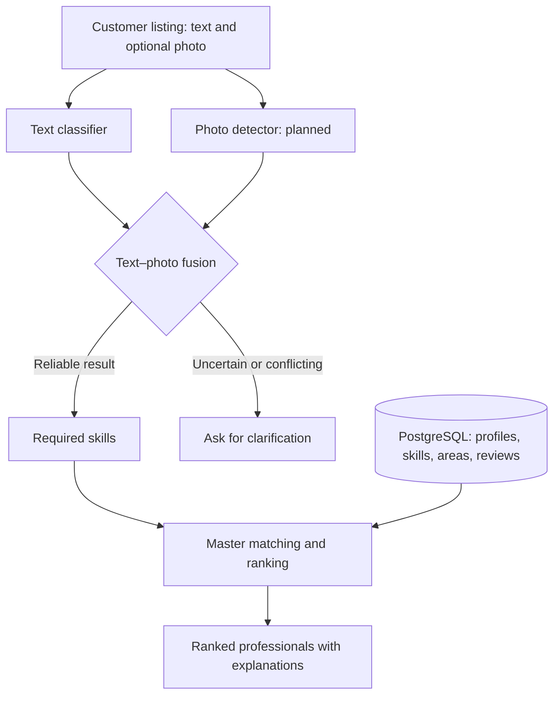

# Tapdix

> An AI-assisted marketplace connecting customers who need repairs with suitable local service professionals.

Tapdix is **Azerbaijani-first**: customers can describe a problem in Azerbaijani or Russian, including informal wording, missing diacritics and typos.

**Status:** Working portfolio prototype. **All reported ML results come from synthetic or author-written evaluation data, not real customer activity.** The web and API are not yet a complete marketplace application.

## Contents

1. [Overview](#1-overview)
2. [How It Works](#2-how-it-works)
3. [Project Status](#3-project-status)
4. [Tech Stack](#4-tech-stack)
5. [Project Structure](#5-project-structure)
6. [Dataset](#6-dataset)
7. [Machine Learning & AI](#7-machine-learning--ai)
8. [Database & Backend](#8-database--backend)
9. [Getting Started](#9-getting-started)
10. [Limitations & Roadmap](#10-limitations--roadmap)
11. [Glossary](#11-glossary)
12. [Author & License](#12-author--license)

---

## 1. Overview

A customer posts a request such as **“Mətbəx kranı su axıdır, təcili lazımdır”** (“The kitchen faucet is leaking; I need urgent help”). Tapdix aims to:

1. Identify the repair category, problem type and required skills from the description.
2. Use photo evidence when available, or ask for clarification if the information is uncertain.
3. Rank suitable service professionals using skills, location, ratings, experience, verification and urgency fit, with human-readable explanations.

The taxonomy covers **8 service categories, 56 problem types and 54 skills**: plumbing, electrical services, locksmith services, appliance repair, automotive repair, electronics repair, painting and renovation, and HVAC services.

## 2. How It Works



The **text classifier, decision rules and rule-based matcher** are implemented. Photo understanding is currently represented by **simulated detections**; the YOLO detector itself has not been trained.

## 3. Project Status

| Component | Status |
|---|---|
| Taxonomy and reproducible synthetic data | Built |
| NLP problem classifier | Built; tested on synthetic and author-written data |
| Text–photo fusion rules | Built; tested with simulated photo detections |
| Explainable rule-based master matcher | Built |
| Legacy scorer port and parity tests | Built |
| PostgreSQL schema, migrations and assertions | Built |
| REST API | Skeleton; health endpoint only |
| React web app | Scaffold; screens not yet implemented |
| YOLO photo detector | Planned |
| Learned ranking model | Planned; requires real outcomes |
| Real-user data collection | Not started |

## 4. Tech Stack

| Layer | Technologies |
|---|---|
| ML / NLP | Python 3.12, scikit-learn, TF-IDF, logistic regression, NumPy, SciPy |
| Database | PostgreSQL 16, SQL migrations and constraints |
| API | FastAPI, Pydantic |
| Web | React 19, TypeScript 6, Vite 8, Tailwind CSS 4 |
| Testing / CI | pytest, ruff, Vitest, GitHub Actions |
| Planned ML | Ultralytics YOLO, LightGBM, sentence-transformers, MLflow |

## 5. Project Structure

```text
tapdix/
├── apps/web/           # React frontend scaffold
├── services/api/       # FastAPI backend scaffold
├── ml/
│   ├── src/tapdix_ml/  # Text processing, NLP, fusion, matching, pipeline
│   ├── data/           # Taxonomy, synthetic data, gold set, vision labels
│   ├── reports/        # Model evaluation results
│   └── tests/          # ML tests
├── db/                 # Database migrations, seeds, verification
├── legacy/             # Original TypeScript rule-based scorer
├── docs/               # Technical audits and supporting documentation
└── .github/workflows/  # CI configuration
```

## 6. Dataset

Since real marketplace data has not been collected, the prototype uses a **reproducible synthetic dataset**:

| Data | Size / Details |
|---|---|
| Listings | 4,480 (56 problem types × 80) |
| Language | Approximately 83% Azerbaijani and 17% Russian |
| Text variation | Missing diacritics, typos, mixed case and vague requests |
| Masters | 400 synthetic profiles with skills, service areas and ratings |
| Independent gold set | 80 clear and 12 vague author-written messages |
| Photos | None collected; indexing and label structures are prepared |

Training and test examples are **split by phrasing** to reduce memorization of repeated wording. The gold set was written separately from the training phrase bank, but by the same author, so it is not an independent real-world benchmark.

The shared taxonomy is maintained in `ml/data/taxonomy/taxonomy.json` and used to generate the corresponding SQL seed.

## 7. Machine Learning & AI

### 7.1 Models and approaches

| Module | Approach | Purpose |
|---|---|---|
| Text classification | Character and word TF-IDF + multinomial logistic regression | Predict one of 56 problem types and its service category |
| Confidence handling | Threshold-based abstention | Ask for clarification instead of forcing uncertain predictions |
| Text–photo fusion | Deterministic decision rules | Combine text and simulated photo predictions or flag disagreement |
| Master matching | Weighted, explainable rule-based score | Rank eligible professionals by relevant criteria |
| Computer vision (planned) | YOLO fine-tuning | Recognize objects and repair-related defects in photos |
| Learned ranking (planned) | LightGBM | Learn ranking from real hiring and service outcomes |

The matcher applies eligibility filters and scores skill coverage (40%), rating (20%), experience (10%), verification (10%), urgency fit (10%) and area (10%). These weights are hand-set, **not learned from user behavior**.

### 7.2 Evaluation results

| Evaluation set | Samples | Category accuracy | Problem-type accuracy |
|---|---:|---:|---:|
| Synthetic test with unseen phrasings | 1,000 | **88.6%** | **62.8%** |
| Author-written clear-message gold set | 80 | **98.75%** | **95.0%** |

The difference between these sets reinforces that the figures **must not be interpreted as expected production accuracy**.

At the selected category-confidence threshold of **0.30**, the system retained **61.1% of clear test listings**, with **98.7% accuracy on retained cases**; **3.1% of evaluated vague messages were wrongly accepted**. These are synthetic/author-written evaluation results, not a real-world reliability guarantee.

### 7.3 Engineering decisions

- Category probabilities are derived from problem-type probabilities to keep predictions consistent.
- Low-confidence or conflicting signals trigger clarification rather than an automatic match.
- Ranking outputs include understandable reasons; Bayesian-adjusted ratings reduce small-review-count bias.
- The original TypeScript scorer was ported to Python and checked with **323 parity tests**.

Detailed metrics and methodology: `ml/reports/text_clf_report.json` and documentation in `docs/`.

## 8. Database & Backend

**PostgreSQL** stores user roles, customer and master profiles, skills, service areas, listings, offers, jobs, reviews, messages and model predictions. Migrations enforce data integrity through keys, checks, indexes and triggers; the repository includes **22 SQL verification assertions**.

Privacy-related controls are incorporated into the database and ML preparation pipeline, including an ML-training consent field, a restricted training-data view and phone/e-mail redaction. These controls have not been validated through a production security audit.

The **FastAPI** service currently exposes a health endpoint; integrating the recommendation pipeline is a next step. The **React** app is a tested scaffold, not a completed customer-facing UI.

For implementation details, see [`docs/sql_audit.md`](docs/sql_audit.md).

## 9. Getting Started

**Requirements:** Python 3.12 and dependencies from `requirements.txt`. PostgreSQL is needed for the database setup; the web scaffold has separate Node.js dependencies.

### Windows (PowerShell)

```powershell
git clone https://github.com/khumar-xanim/tapdix.git
cd tapdix
powershell -ExecutionPolicy Bypass -File .\setup.ps1
.\.venv\Scripts\Activate.ps1
$env:PYTHONPATH = "ml/src"
pytest -q
```

### Linux / macOS

```bash
python3.12 -m venv .venv
source .venv/bin/activate
pip install -r requirements.txt
export PYTHONPATH=ml/src
pytest -q
```

### Try the ML demo

```powershell
python -m tapdix_ml.demo "Mətbəx kranı su axıdır, təcili" --district Nərimanov --urgency Urgent
python -m tapdix_ml.demo "paltaryuyan sixmir, cox ses salir"
python -m tapdix_ml.demo "Kömək lazımdır"
```

The photo detector can be **simulated**, not run as a trained model:

```powershell
python -m tapdix_ml.demo "Usta lazımdır, şəkildə görünür" --detect ac_indoor_unit:0.9 --detect water_leak_stain:0.7
```

### Optional: database setup (Windows)

```powershell
psql -U postgres -c "CREATE DATABASE tapdix"
powershell -ExecutionPolicy Bypass -File db\apply_all.ps1 -Db tapdix
```

## 10. Limitations & Roadmap

**Current limitations:** Results rely on synthetic and author-written data; no photo model is trained; matcher weights are manually defined; multi-problem listings are not decomposed; and the API and frontend remain incomplete. Real-user performance, load behavior and production security have not been validated.

**Next milestones:**

1. Collect consented real listings, independent labels and real service outcomes.
2. Connect the recommendation pipeline to FastAPI and build marketplace screens.
3. Collect and annotate photos, then fine-tune and evaluate YOLO.
4. Train and compare a learned ranker against the rule-based matcher.
5. Evaluate stronger multilingual text representations and production monitoring.

## 11. Glossary

| Term | Description |
|---|---|
| **NLP** | Processes Azerbaijani and Russian listings to identify repair problems. |
| **Computer Vision (YOLO)** | Planned image-based detection of objects and defects. |
| **Taxonomy** | Defines service categories, problem types and skills. |
| **Synthetic Data** | Artificially generated data used for development and initial evaluation. |
| **Baseline** | Reference scoring system used to compare future approaches. |
| **Confidence & Abstention** | Accepts sufficiently confident predictions or requests clarification. |
| **Text–Photo Fusion** | Combines text and photo evidence in the decision process. |
| **Master Matching** | Ranks service professionals based on eligibility and matching criteria. |

## 12. Author & License

**Developed by:** [Khumar Gurbanova](https://github.com/khumar-xanim/)

**License:** Not yet specified.
